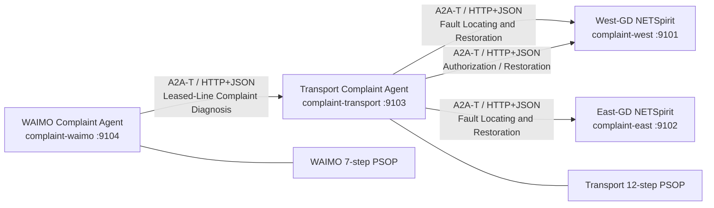
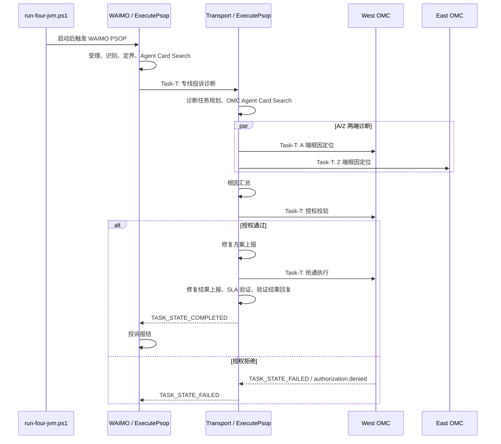
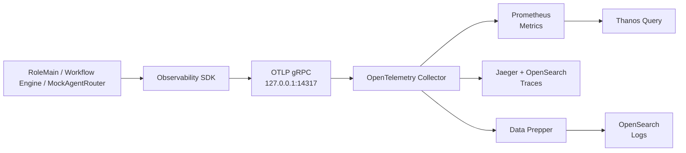

# 投诉处理 Demo 运行逻辑

本文描述当前四 JVM 运行模式。它对应 `observability-sdk-java` PR #39 的分层 PSOP：WAIMO 和 Transport 各自加载并执行自己的 workflow，OMC Agent 只承接具体的诊断、授权和抢通任务。

完整场景包 `psop_Complaint_Handling.json` 有 16 个业务步骤，用于说明端到端故事线；实际运行时不会由单一引擎直接执行这 16 步。WAIMO 运行 7 步 PSOP，Transport 在收到诊断任务后运行 12 步 PSOP。

## 1. 进程、Agent 和 SDK 的关系

`run-four-jvm.ps1` 会按 West、East、Transport、WAIMO 的顺序启动四个独立 JVM。每个 JVM 都运行 `RoleMain`，启动一个 HTTP+JSON A2A 服务、提供自己的 Agent Card，并创建一个 `ObservabilitySdk` 实例。



| 角色 | 是否执行 PSOP | 主要职责 | 服务名 |
| --- | --- | --- | --- |
| WAIMO Complaint Agent | 是，7 步 | 投诉受理、意图识别、定界、Transport 选择、结果闭环 | `complaint-waimo` |
| Transport Complaint Agent | 是，12 步 | OMC 诊断编排、根因汇总、授权、抢通、SLA 验证和结果回传 | `complaint-transport` |
| West-GD NETSpirit | 否 | A 端 OMC 诊断；当前 fixture 也作为 Selected OMC 承接授权和抢通 | `complaint-west` |
| East-GD NETSpirit | 否 | Z 端 OMC 诊断 | `complaint-east` |

`Selected OMC Agent` 是此 demo 的确定性映射，当前指向 West-GD NETSpirit 的 HTTP 地址。真实环境中应由注册中心/选择策略确定，而不是固定映射。

## 2. Workflow Engine 如何执行

Workflow Engine SDK 作为 Java 依赖运行在 WAIMO 和 Transport 进程中，并没有单独部署一台 workflow engine 服务。

1. WAIMO 读取 `psop_Complaint_Handling_WAIMO.json`，用 `ExecutePsop` 创建执行实例。
2. 引擎按 `step` 的 `next` 和条件推进；每个 `subtask` 交给 `WorkflowEngineClient`。
3. `ComplaintControlPoint` 是业务回调：
   - `onTask` 将 workflow 任务转换为 A2A-T 消息；
   - `onSelfTask` 完成当前 Agent 的本地任务；
   - `onRoute` 根据 `success` 或 `authorization-denied` 场景决定条件分支。
4. WAIMO 在 step5 发起对 Transport 的诊断任务。Transport 服务端识别该任务后，调用 `LayeredTransportWorkflow`，加载 `psop_Complaint_Handling_Transport.json` 并执行自己的 PSOP。
5. Transport step3 包含 West 和 East 两个 subtask，引擎并发派发；后续根因汇总、授权、抢通、SLA 验证按 PSOP 条件继续。
6. Transport 成功返回后，WAIMO 执行投诉报结；授权拒绝案例则在 Transport 授权校验处失败，WAIMO 不会进入投诉报结。



运行结束后，WAIMO 写入 `artifacts/<run_id>.json`；四个角色各写入 `artifacts/<run_id>.<role>.json`。前者保存 workflow history、step output 和事件，后者保存该 Agent 收到和完成的任务记录。

## 3. A2A-T 是怎样通信的

通信底座是 A2A Java SDK 的 HTTP+JSON `SendMessage`。每个 Agent 服务公开 `/.well-known/agent-card.json`，其 Agent Card 声明支持 Task-T 扩展。Workflow Engine 的 `A2ATransport` 按 Agent 名称选中 Card，再调用 `SocketA2AJavaClientRuntime` 发送请求。

```mermaid
flowchart LR
    P[PSOP subtask] --> CP[ComplaintControlPoint.onTask]
    CP --> A2ATClient[A2A-T Client SDK<br/>生成标准提示词和 MetadataContent]
    A2ATClient --> M[MessageContent<br/>TextPart + metadata + Task-T extension URI]
    M --> C[A2ATransport / A2A Java Client]
    C --> H[HTTP+JSON SendMessage]
    H --> S[A2A Java Server]
    S --> A2ATServer[A2A-T Server SDK<br/>校验提示词合规性]
    A2ATServer --> R[MockAgentRouter]
    R --> Result[TASK_STATE_COMPLETED 或 TASK_STATE_FAILED]
```



具体过程如下：

1. `TaskTCodec` 用 A2A-T Client SDK 把 workflow 的任务描述生成 Task-T 标准提示词和 `MetadataContent`。
2. `ComplaintControlPoint` 写入 demo 关联字段：`demo.run_id`、`demo.task_id`、`demo.step`、`demo.skill`、`demo.agent`。
3. A2A Java Client 通过 HTTP+JSON 向目标 Agent 发送 `SendMessage`。返回结果使用标准 A2A Task 状态：成功为 `TASK_STATE_COMPLETED`，失败为 `TASK_STATE_FAILED`。
4. 服务端 A2A Java Server 解析请求，A2A-T Server SDK 校验 Task-T prompt。校验通过后进入 `MockAgentRouter`。
5. Router 根据 skill 执行确定性业务逻辑，构造结果文本和 Artifact；拒绝案例在 `Network Operation Authorization` 返回 `authorization.denied`。

MockAgent 并不调用真实网络系统或大模型。`StaticLlmClient` 让 A2A-T 提示词生成和合规校验可重复运行；诊断结果、SLA 结果、授权结果和少量时延均是 fixture。A2A、A2A-T、Workflow Engine 和 Observability SDK 的调用链则是实际 SDK 调用。

## 4. Trace 如何连成一条调用链

WAIMO 开始执行时创建根 `a2at.workflow` span。Workflow Engine 继续产生 workflow/step span；A2A 客户端在 `SendMessage` 前创建 CLIENT span，并把 W3C `traceparent` 注入 HTTP header。目标 Agent 的 HTTP 服务提取 header 后，把它设为当前上下文，再创建处理 span。

Workflow Engine 的任务派发存在异步边界。`TraceParentRegistry` 以 `task_id` 保存显式父 span；如果异步线程没有 `Context.current()`，客户端会从注册表取回父 span。这样 WAIMO → Transport 和 Transport → OMC 不会因线程切换而断开 Trace。

关联键的职责：

| 键 | 作用 |
| --- | --- |
| `traceparent` / `traceId` | 跨 HTTP 服务连接同一次调用链；在 Jaeger 中查看父子 Span |
| `task_id` | workflow 任务和异步父 span 的对应键 |
| `context_id` | A2A 消息上下文属性 |
| `run_id` | demo 一次运行、角色报告和业务任务日志的检索键 |
| `service.name` | 区分 WAIMO、Transport、West、East 的遥测来源 |

## 5. 信号如何产生、上报和存储



启用 `-EnableTelemetry` 后，启动脚本向四个 JVM 注入 `OTEL_EXPORTER_OTLP_PROTOCOL=grpc` 和 `OTEL_EXPORTER_OTLP_ENDPOINT=http://127.0.0.1:14317`。每个进程中的 Observability SDK 将信号经 OTLP 发给 Collector：

| 产生位置 | Trace | Metric | Log |
| --- | --- | --- | --- |
| Workflow Engine 的 `ExecutePsop` | `a2at.workflow`、`a2at.step.<step>` | workflow 次数/耗时、step 耗时 | workflow 与 step 的 started/completed/failed |
| A2A 客户端运行时 | `SendMessage` CLIENT | `gen_ai.client.operation.duration` | 无额外业务日志 |
| MockAgent Router | `SendMessage` SERVER 及任务处理 span | Task-T 次数/耗时、substep 耗时、通知次数、授权预校验次数/耗时 | Task-T 消息日志、`demo.task` 业务记录 |

Collector 按信号类型分流：

- Metrics 通过 OTLP HTTP 写入 Prometheus；Thanos Query 读取 Prometheus 数据块。
- Trace 通过 OTLP 写入 Jaeger，Jaeger 使用 OpenSearch 作为后端存储。
- Log 通过 OTLP 写入 Data Prepper，Data Prepper 写入 OpenSearch 的 `a2at-logs-v2` 索引。

本地查看方式、端口和全量查询命令见 [LOCAL_STORAGE_VIEWING.md](LOCAL_STORAGE_VIEWING.md)；已覆盖及未覆盖的 SDK 信号见 [SIGNAL_COVERAGE.md](SIGNAL_COVERAGE.md)。

## 6. 一次完整运行的命令

```powershell
.\scripts\start.ps1
.\scripts\run-four-jvm.ps1 -Case success -RunId complaint-success-001 -EnableTelemetry
.\scripts\verify-storage.ps1 -Case success -RunId complaint-success-001 -ServiceName complaint-waimo
```

`run-four-jvm.ps1` 会在报告生成后调用停止脚本退出四个 Agent JVM；本地存储仍然运行，方便继续在 Prometheus、Jaeger 和 OpenSearch 查看本次数据。完成查看后可执行：

```powershell
.\scripts\stop.ps1
```
