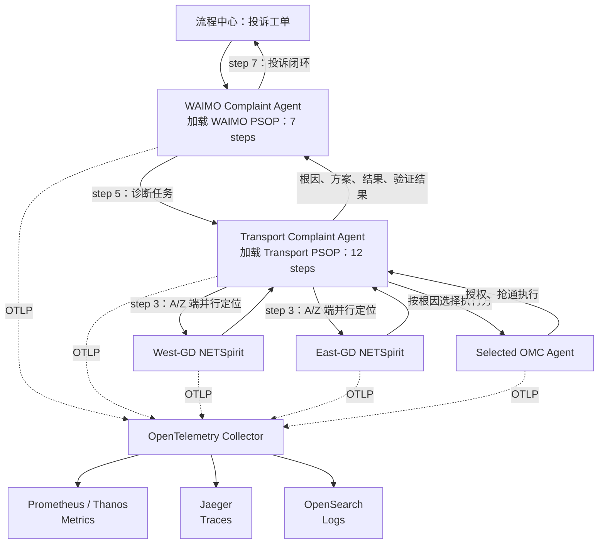

# 分层 PSOP Demo 改造说明

## 1. 基线与目标

本说明以 [observability-sdk-java PR #39](https://github.com/project-openan/observability-sdk-java/pull/39) 的投诉处理故事线为准。该 PR 提供同一场景的三个资源：

| 资源 | 角色 | 步数 | Demo 中的用途 |
| --- | --- | ---: | --- |
| `psop_Complaint_Handling.json` | 全链路方案包 | 16 | 场景说明、端到端步骤映射和验收依据；不由单一 Agent 直接执行。 |
| `psop_Complaint_Handling_WAIMO.json` | WAIMO 编排层 | 7 | WAIMO Agent 加载并执行的顶层 PSOP。 |
| `psop_Complaint_Handling_Transport.json` | Transport 编排层 | 12 | Transport Complaint Agent 收到诊断任务后加载并执行的子 PSOP。 |

PR #39 没有提供独立的 OMC PSOP 文件。West/East/Selected OMC Agent 继续作为 Task-T 的任务执行方：根因定位、授权校验/请求、抢通执行。Demo 不伪造第三份 OMC PSOP；如后续上游提供该资源，再将 OMC 任务替换为本地 PSOP 执行器。

## 2. 运行结构

`traceparent` 在 WAIMO 到 Transport、Transport 到 OMC 的 HTTP A2A 请求头中传递。子 Agent 从入站请求继续当前 Trace；其本地 workflow、step、Task-T client/server span 均成为入站 A2A server span 的后代。A/Z 并行任务共享 Transport workflow span 作为父级，彼此没有父子关系。

## 3. 需要完成的代码改造

1. 从 PR #39 固化三个资源及其源 commit；替换当前 PR #29 的单一 7 步资源。
2. 将现有四 JVM 角色调整为 WAIMO、Transport、West OMC、East OMC；`Selected OMC Agent` 在成功路径固定选 West，用于保证可重复的断言。
3. WAIMO 仅执行 WAIMO PSOP。其 step 5 通过 A2A/Task-T 调用 Transport，等待 Transport 的最终诊断/处置结果后继续 step 6、step 7。
4. Transport 在收到 WAIMO 的任务时执行 Transport PSOP，并在 step 3 并行调用 West/East；后续步骤按授权、修复、SLA 结果走分支。
5. 把授权拒绝改到 Transport 的授权校验/请求分支；增加 `repair-failed`、`sla-not-recovered` 两条人工修复路径，保留 `success`。
6. 每个 JVM 使用独立 `service.name` 和独立 `ObservabilitySdk`。运行报告新增 `workflowRuns`、`selectedOmcAgent`、`branch` 和跨 Agent 调用关系。
7. 更新 `verify.ps1`、`verify-multiprocess.ps1`、`verify-storage.ps1`：验证两个 workflow 根/子层次、父子闭包、并行 A/Z span，以及三类存储中的同一 `run_id`。

## 4. 指标覆盖基线

下表的“当前”针对现有 PR #29 Demo；“目标”是本次分层改造完成后的验收要求。指标名为导出到 Prometheus 的名称。

| 指标 | 当前 | 目标 | 成功路径可断言值 |
| --- | --- | --- | --- |
| `gen_ai_agent_a2at_workflow_count_total` | 已有 | WAIMO 与 Transport 分别记录 | 两条 `status=completed` 时间序列，各增加 `1`。 |
| `gen_ai_agent_a2at_workflow_duration_milliseconds` | 已有 | 两个工作流都记录 | 各产生 `count=1`；值来自实际运行耗时，不写死毫秒数。 |
| `gen_ai_agent_a2at_step_duration_milliseconds` | 已有 | WAIMO 成功路径 6 步、Transport 成功路径 10 步 | 按 `workflow.step` 聚合：WAIMO 为 step1 至 step6；Transport 为 12 步定义中的 10 个成功分支步骤，跳过 step8 和 step10。 |
| `gen_ai_agent_a2at_substep_duration_milliseconds` | 缺失 | 每次 OMC 任务执行记录 | 成功主路径至少 5 个样本：A 端定位、Z 端定位、授权校验、抢通执行、SLA 验证。 |
| `gen_ai_agent_a2at_task_count_total` | 部分 | 每个 Task-T 请求记录 | 成功主路径至少 5 次逻辑任务；每个 `task.type` 的 counter 增量为 `1`。 |
| `gen_ai_agent_a2at_task_duration_milliseconds` | 部分 | 每个 Task-T 请求记录 | 与 task count 一一对应；`count` 至少为 5，具体耗时由运行产生。 |
| `gen_ai_client_operation_duration_seconds` | 缺失 | 每次 A2A client 操作记录 | 至少覆盖 WAIMO→Transport、Transport→West、Transport→East、Transport→Selected OMC 四类调用；成功样本的 `count` 至少为 4。 |
| `gen_ai_agent_a2at_authorization_preauthorize_count_total` | 缺失 | 授权校验记录 | 成功路径增加 `1`；拒绝路径增加 `1` 且进入授权请求。 |
| `gen_ai_agent_a2at_authorization_preauthorize_duration_milliseconds` | 缺失 | 授权校验耗时记录 | 成功、拒绝路径各有一个 `count=1` 样本。 |
| `gen_ai_agent_a2at_authorization_execute_count_total` | 缺失 | 授权请求完成时记录 | 成功路径为 `0`（预授权已通过）；拒绝并补授权成功路径为 `1`。 |
| `gen_ai_agent_a2at_notification_count_total` | 缺失 | 根因、修复方案、修复结果、验证结果上报记录 | 成功路径至少 4 个样本，按 `notification.topic` 分组，每组增量 `1`。 |
| `gen_ai_agent_a2at_negotiation_count_total` | 缺失 | 本故事线不制造协商 | 保持无样本；只有引入真实协商时才增加。 |
| `gen_ai_client_token_usage_total` | 缺失 | MockAgent 无模型调用 | 保持无样本；切换真实 LLM Agent 后按 input/output token 上报。 |

数值分为两类：计数器的增量、样本数量和分支结果必须精确断言；耗时直方图的每个值依赖本机调度和网络，不应固定为某个毫秒数，只断言大于零、样本数及标签。

## 5. 本地查看三类数据的方式

本地存储栈启动后，Demo 的 `run_id` 是三类查询的共同过滤条件。验证脚本会把原始响应保存为 `artifacts/<run_id>.storage.json`。

| 数据 | 存储/API | 示例 |
| --- | --- | --- |
| Metrics | Prometheus `:19090/api/v1/query` | `query=gen_ai_agent_a2at_workflow_count_total{service_name="complaint-waimo"}` |
| Traces | Jaeger `:16686/api/v3/trace-summaries` 和 `/api/v3/traces/{traceId}` | 先按 `query.serviceName` 找摘要，再取 trace 明细。 |
| Logs | OpenSearch `:19200/a2at-logs-v2/_search` | 查询 `attributes.run_id`，获得 workflow、step、Task-T 日志。 |

后续的 `observability-query-service` 将把这三类原始接口封装为 Portal 使用的一套 REST API；在该服务实现前，`verify-storage.ps1` 与以上原始 API 是本地验收入口。

## 6. 验收路径

| 用例 | 预期结果 |
| --- | --- |
| `success` | WAIMO 7 步、Transport 12 步、A/Z 并行定位、授权通过、抢通成功、SLA 恢复、两个 workflow 均 completed。 |
| `authorization-denied` | Transport 授权校验失败，发起授权请求后拒绝，转 WAIMO 人工修复；两个 workflow 的终态和已执行步骤与分支一致。 |
| `repair-failed` | 自动抢通失败，转人工修复。 |
| `sla-not-recovered` | 自动抢通完成但 SLA 未恢复，转人工修复。 |

每条用例都要同时验证：运行报告、Metrics、Trace 的单一 Trace ID 与完整父子闭包、Logs 中的 `run_id`。
