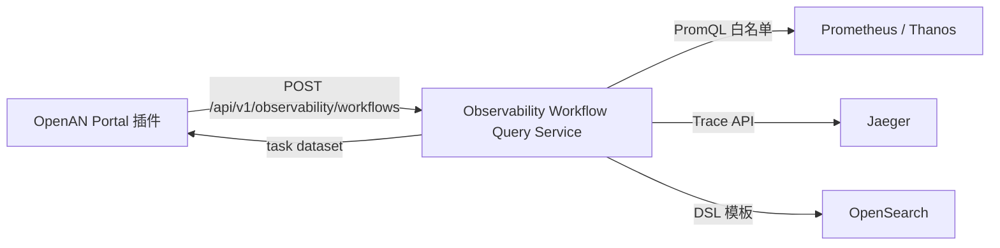

# Observability Workflow Query Service

面向 OpenAN Portal 的统一只读查询服务。它把 Prometheus、Jaeger 和 OpenSearch 的各自查询协议收敛为 Workflow 视图；Trace 与 Log 响应保持 OTLP 结构，Portal 不直接访问三类存储，也不保存其账号或地址。

## 第一阶段范围

- 以 `runId` 为 Workflow 资源主键，返回 Workflow 列表、详情、Trace、Log 和 Metric；
- 详情返回 PSOP 原始结构；
- Trace 返回 OTLP `ExportTraceServiceRequest`；
- Log 返回 OTLP `LogRecord`；
- Metric 返回白名单聚合后的 Workflow 指标；
- 故障时返回分数据源状态，避免把“部分数据暂不可用”显示成“任务不存在”。

不包含写入、删除、原始 PromQL / DSL 透传、跨租户聚合和鉴权对接；这些需要 Portal 的身份与租户模型明确后再加入。

## 服务边界



## 接口

完整定义见 [openapi.yaml](openapi.yaml)。首批接口：

| 方法 | 路径 | 说明 |
| --- | --- | --- |
| `GET` | `/healthz` | 服务及三类数据源连通性 |
| `POST` | `/api/v1/observability/workflows` | 查询 Workflow 列表 |
| `GET` | `/api/v1/observability/workflows/{runId}` | 查询 Workflow 详情，`steps` 为 PSOP 结构 |
| `POST` | `/api/v1/observability/workflows/{runId}/trace` | 查询 OTLP Trace |
| `POST` | `/api/v1/observability/workflows/{runId}/logs` | 查询 OTLP Log |
| `POST` | `/api/v1/observability/workflows/{runId}/metrics` | 查询 Workflow Metric |

详情响应保留 `sourceStatus` 字段：`ready`、`empty`、`unavailable` 或 `partial`。只有三类查询均成功且数据完整时，Workflow 详情的 `partial` 为 `false`。

## 本地启动

```powershell
python observability-query-service/server.py
```

默认读取 `dist-plugin/mock-collab-tasks.json` 并在 `8787` 端口提供接口。可通过 `PORT` 调整端口。

## 代码结构

```text
server.py       HTTP 路由和请求响应处理
service.py      查询编排、过滤、分页和排序
repository.py   数据文件读取与 Workflow 查找
models/         响应模型
  workflow.py   Workflow 摘要、详情、PSOP 和聚合
  trace.py      OTLP ExportTraceServiceRequest
  log.py        OTLP LogRecord
  metric.py     Metric、信号和图表
```

## 数据源配置

服务从环境变量读取地址和认证信息；密钥不进入前端包和 Git：

```text
OBS_PROMETHEUS_URL=http://prometheus:9090
OBS_JAEGER_URL=http://jaeger-query:16686
OBS_OPENSEARCH_URL=https://opensearch:9200
OBS_OPENSEARCH_INDEX=a2at-logs-v2
OBS_QUERY_TIMEOUT_MS=5000
```

实现时按以下顺序推进：先完成 Jaeger 任务列表与详情适配，再加入 OpenSearch 日志关联和 Prometheus 指标聚合，最后让 Portal 的 `__OPENAN_OBS_DATA_URL__` 改为本服务地址并增加登录态转发。
